<div align="center">

<h1>Video Claw</h1>
<p><strong>把参考视频里的剪辑经验，变成你的创作资产。</strong></p>
<p>参考片拆解 · 素材理解 · 分镜策划 · 视频生成 · 知识沉淀</p>
<p>Python · FastAPI · React · Remotion · FFmpeg · 多模态模型</p>
<p><a href="#效果预览">效果预览</a> · <a href="#产品界面">产品界面</a> · <a href="#真实运行记录">真实运行记录</a> · <a href="#快速体验">快速体验</a></p>

</div>

Video Claw 是一个面向短视频创作的多智能体应用。上传参考视频，配上自己的图片或视频素材，系统会提取镜头结构、节奏、情绪和包装手法，生成可编辑分镜，确认后输出成片，并把本次分析中的可复用经验沉淀到基因库、知识库和统计洞察中。

## 效果预览

先看实际效果：**五官贴纸、撕纸描边、RGB 故障、音乐浮层**。下方四格同时播放，所有画面均来自项目已渲染的视频。

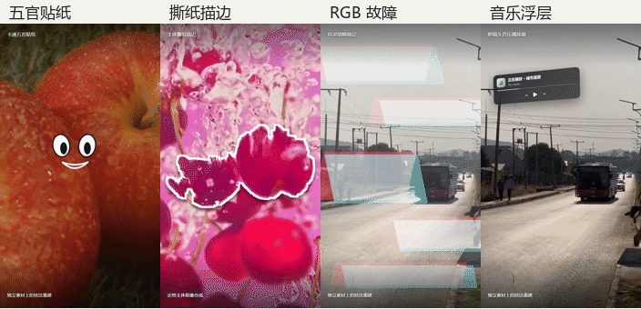

### 贴纸与手绘：让实拍主体有反应

苹果上的眼睛和嘴巴、狗狗头顶的手绘符号、弹入的文字标识，以及引导注意力的指针，都是视频里的实际叠加效果。

<table>
  <tr>
    <th width="50%">卡通五官贴纸</th>
    <th width="50%">头顶手绘反应</th>
  </tr>
  <tr>
    <td align="center"><a href="assets/showcase/sticker-face.gif">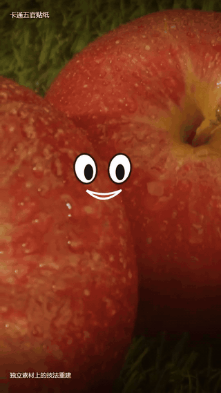</a><br>观察苹果上的眼睛与嘴巴。</td>
    <td align="center"><a href="assets/showcase/sticker-reaction.gif">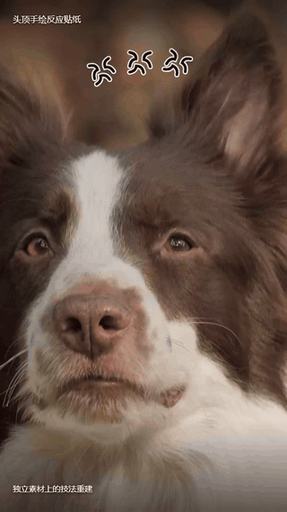</a><br>观察狗狗头顶弹动的手绘符号。</td>
  </tr>
  <tr>
    <th>弹入文字贴纸</th>
    <th>指示箭头贴纸</th>
  </tr>
  <tr>
    <td align="center"><a href="assets/showcase/sticker-pop.gif">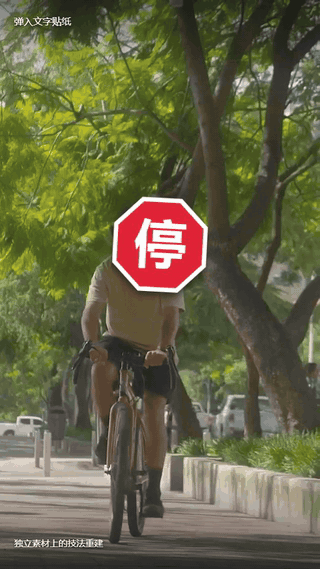</a><br>贴纸弹入，在运动镜头中制造强调。</td>
    <td align="center"><a href="assets/showcase/sticker-arrow.gif">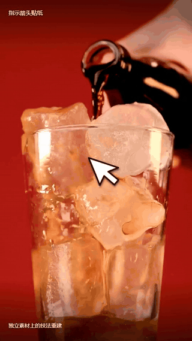</a><br>白色指针引导视线，突出倒饮料的动作。</td>
  </tr>
</table>

### 主体合成：描边、分身与残影

这组三个示例使用同一条樱桃实拍素材，分别演示不同处理。**当前使用定格主体抠像合成**；动态逐帧分割仍在完善中。

<table>
  <tr>
    <th width="50%">主体撕纸描边</th>
    <th width="50%">主体复制增殖</th>
  </tr>
  <tr>
    <td align="center"><a href="assets/showcase/paper-outline.gif">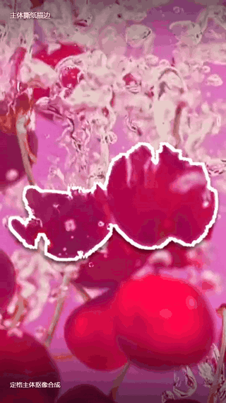</a><br>白色描边沿抠出的樱桃轮廓展开。</td>
    <td align="center"><a href="assets/showcase/subject-clone.gif">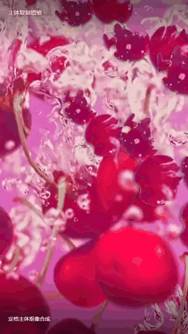</a><br>同一主体逐渐分裂成多个叠加分身。</td>
  </tr>
  <tr>
    <th>多层透明残影</th>
    <th>九宫格线叠层</th>
  </tr>
  <tr>
    <td align="center"><a href="assets/showcase/subject-echo.gif">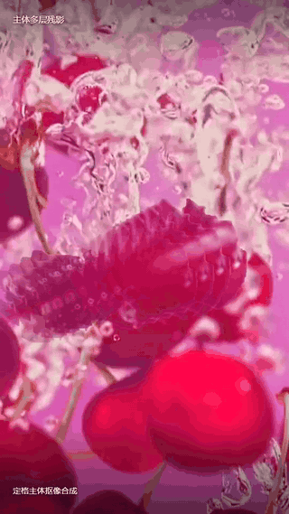</a><br>用透明度和位置差形成主体拖尾。</td>
    <td align="center"><a href="assets/showcase/grid-overlay.gif">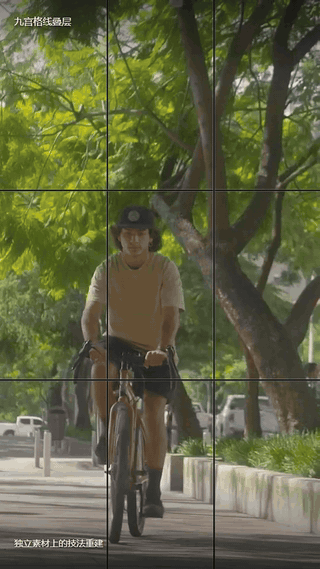</a><br>分割线覆盖在持续运动的实拍画面上。</td>
  </tr>
</table>

### 界面与氛围包装：画面上叠加新的视觉层

<table>
  <tr>
    <th width="50%">RGB 故障叠层</th>
    <th width="50%">悬浮音乐播放器</th>
  </tr>
  <tr>
    <td align="center"><a href="assets/showcase/glitch-overlay.gif">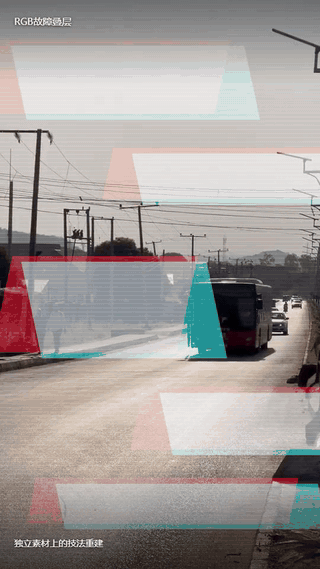</a><br>色块、扫描线与错位脉冲反复出现。</td>
    <td align="center"><a href="assets/showcase/music-player.gif">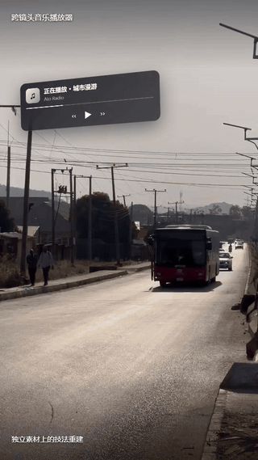</a><br>播放器浮在画面上，进度条持续移动。</td>
  </tr>
  <tr>
    <th>前景图形剪影</th>
    <th>搜索引导片尾</th>
  </tr>
  <tr>
    <td align="center"><a href="assets/showcase/foreground-silhouette.gif">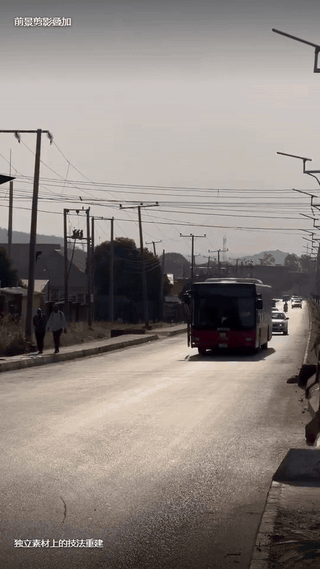</a><br>前景剪影掠过镜头，增加画面层次。</td>
    <td align="center"><a href="assets/showcase/search-outro.gif">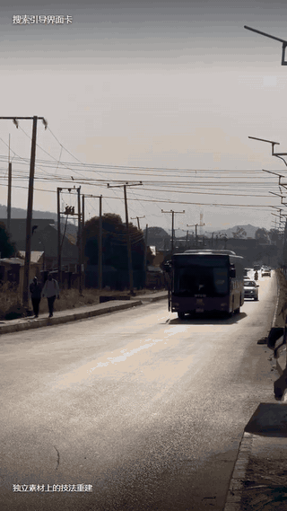</a><br>从实拍镜头进入带搜索框的片尾包装。</td>
  </tr>
</table>

以上 **12 个单项技法**来自个人知识库的效果示例：在独立实拍素材上重建技法，并保留来源与配方。点击任意动图可以打开大图；每段约 3.6 秒，静音循环。

### 连续剪辑：看效果如何进入视频

<table>
  <tr>
    <th width="50%">自动生成成片 · 任务 #16</th>
    <th width="50%">知识库示例 · 城市旅行日记</th>
  </tr>
  <tr>
    <td align="center"><a href="assets/showcase/generated-edit.gif">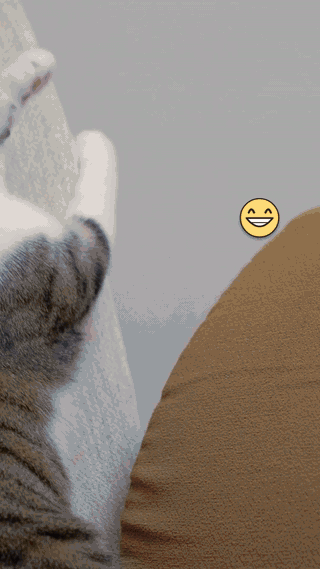</a></td>
    <td align="center"><a href="assets/showcase/travel-transitions.gif">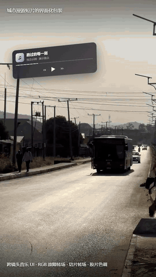</a></td>
  </tr>
  <tr>
    <td>实际端到端任务输出的 7.5 秒节选：多素材切镜、贴纸与手绘反应。完整任务为 22 镜头，审核结果见下文。</td>
    <td>独立教学视频的 9.5 秒节选：连续切镜、故障 / 切片转场与跨镜头播放器包装。</td>
  </tr>
</table>

全部动图已静音、缩小并降帧。展示素材直接随仓库提供，来源与导出参数见 [预览素材说明](assets/showcase/README.md)。

目前已跑通的成果包括：

| 成果 | 已实现的行为 |
| --- | --- |
| 完整创作流程 | 参考分析、素材分析、分镜生成、人工确认、视频渲染、质量复审 |
| 可积累的视频基因 | 保存 Hook、镜头功能、切点、节奏、情绪、特效事件及来源证据 |
| 可观看的剪辑知识 | 结构、节奏、情绪、包装、贴纸和独立特效分类，附原片或剪辑效果示例 |
| 52 个内置技法演示 | 系统技法提供可播放的视频教学，支持按类别浏览 |
| 任务后的自动沉淀 | 自动更新基因、个人知识、剪辑示例和统计快照，展示每项处理状态 |
| 可核查的实际输出 | 一次实测完成 22 镜头、22 条不同视频素材、1080×1920 竖屏与音轨输出 |

## 产品界面

### 创作工作台

项目、任务和创作入口集中在同一个工作台，继续上次的剪辑任务，也可以从新的参考片开始。

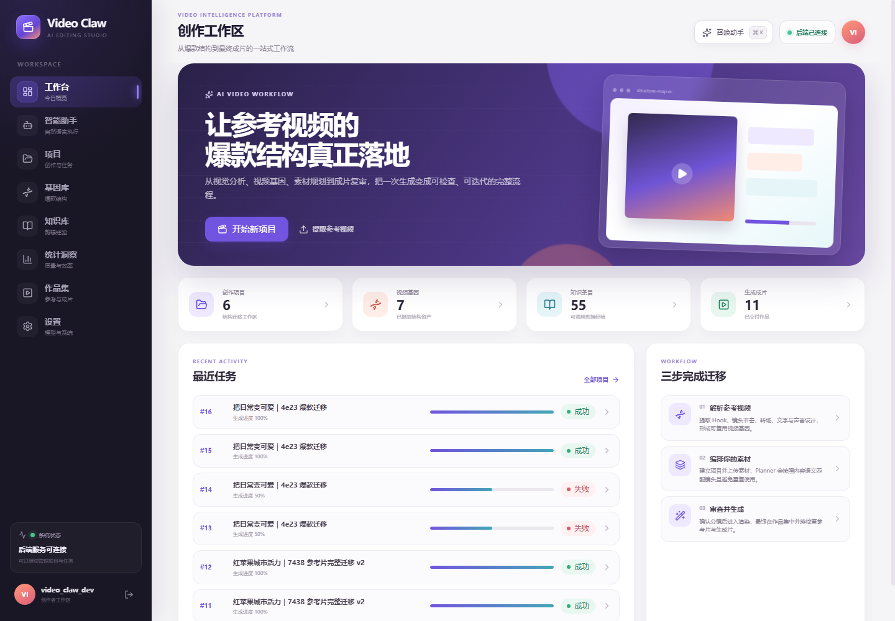

### 基因库：把参考片拆成可以复用的结构

按视频管理分析结果，查看镜头与结构信息，选择已有基因继续创作。参考片的分析可以复用，来源保留在项目和任务中。

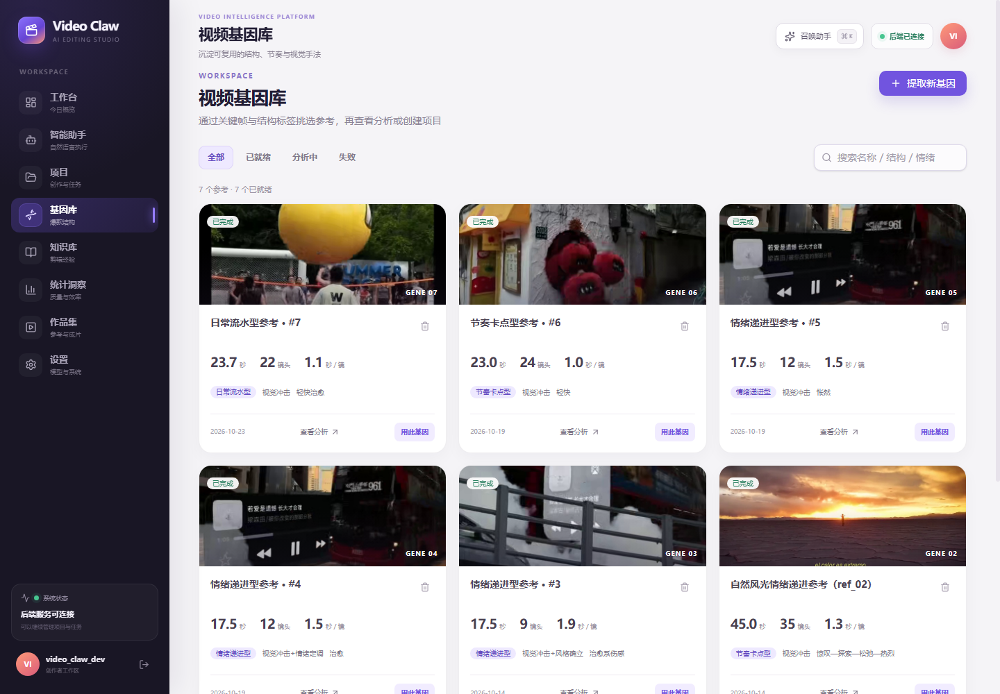

### 知识库：经验有分类，也有真实视频示例

“我的知识”和“系统技法”分别管理。支持结构模板、Hook、节奏、情绪、转场，以及**特效 / 贴纸**等分类，搜索后可以查看用法、来源和示例。

个人知识的效果示例使用独立实拍素材重建；素材不足或技法尚未支持时，页面显示“待补齐”，并保留原片参考。

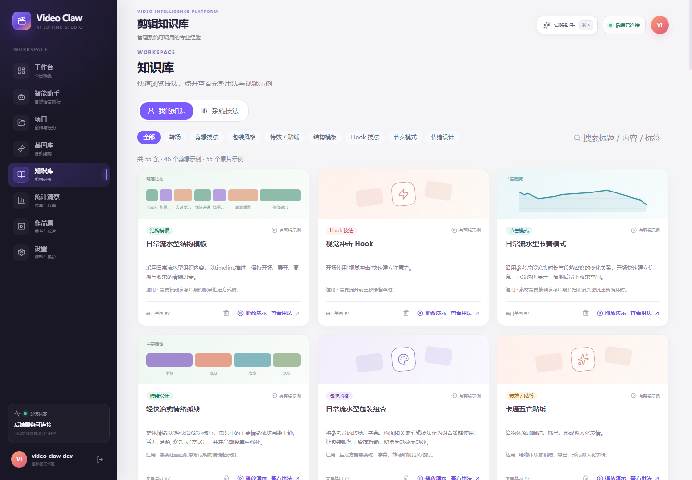

### 任务工作台：确认分镜，观察执行和资产生成

分镜可修改素材、时长、字幕、转场和顺序。渲染后可以播放、下载成片，并查看基因、知识、示例、洞察的自动更新状态。

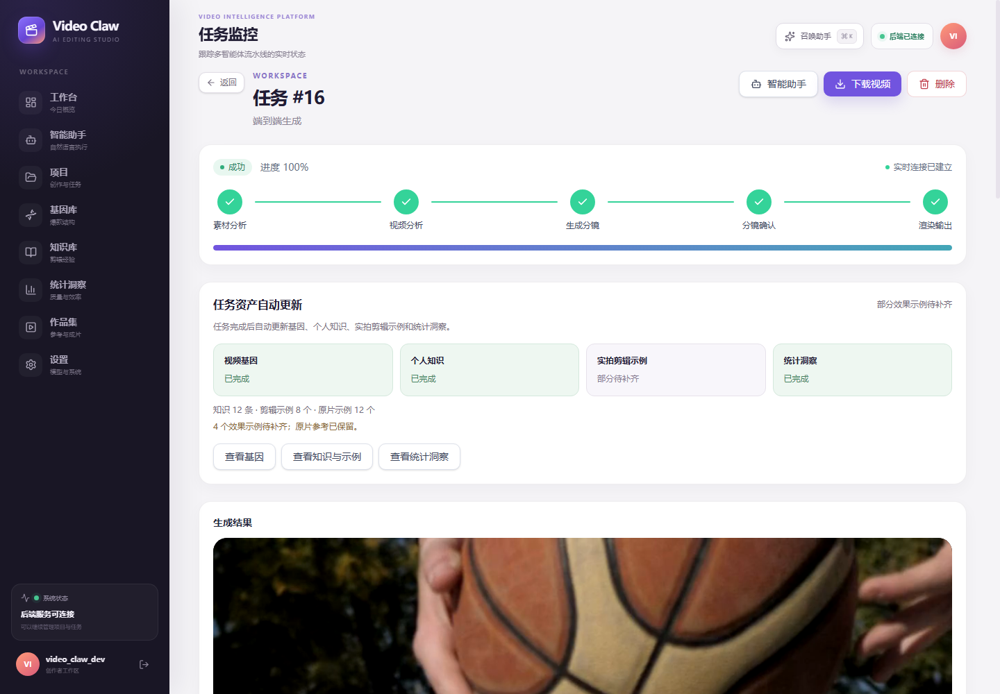

### 作品集与统计洞察：看成片，也看创作积累

作品集集中展示各项目成片，关联参考视频，支持播放和下载。统计洞察汇总当前账号的分析结果，提供单视频与跨视频的结构、节奏、情绪和技法观察。

<table>
  <tr>
    <td width="50%">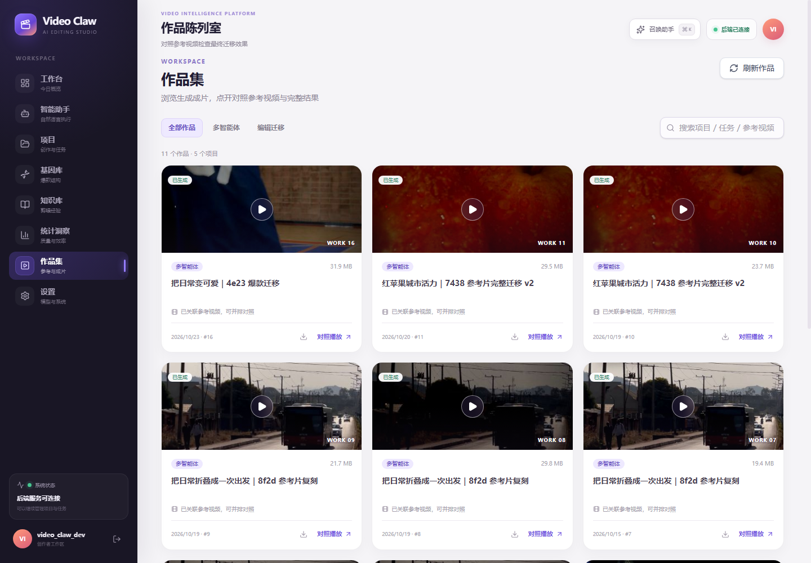</td>
    <td width="50%">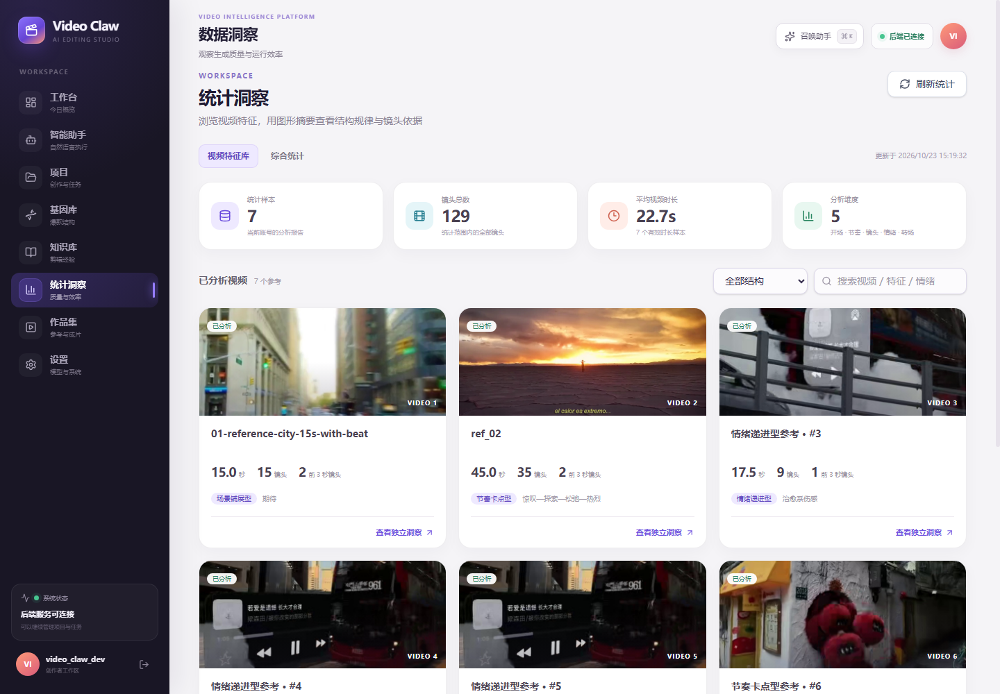</td>
  </tr>
  <tr>
    <td align="center">作品集</td>
    <td align="center">统计洞察</td>
  </tr>
</table>

以上为本地实测账号的页面快照，页面中的数量代表该账号当时的数据。

## 一次任务如何留下创作资产

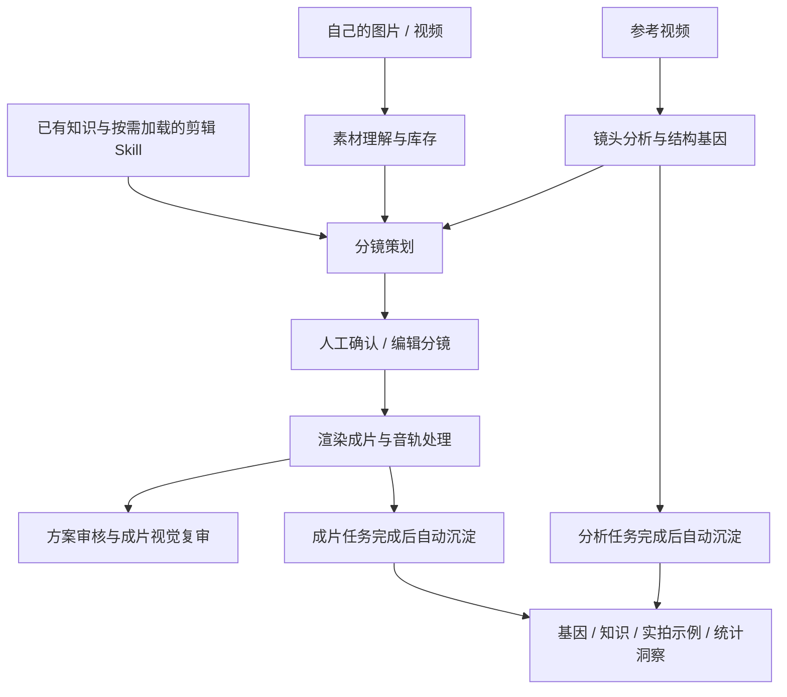

资产生成由独立的持久化队列处理，支持失败重试和服务重启后的恢复；同一来源的已有基因与知识会幂等复用。示例生成的能力缺口会保留为“部分待补齐”，成片仍可查看。

还提供[智能助手](docs/智能助手-使用说明.md)，支持通过自然语言查询项目、查看任务、启动分析和生成分镜；渲染使用明确的确认指令。

## 真实运行记录

以下是 **2026-10-23** 的一次端到端实测，用于展示当前系统能交付什么，以及还有哪些改进空间。参考片为 `4e231786d448bd8f13b2009065c7ad58.mp4`，目标素材由开发者从公开素材站筛选后导入项目。

| 项目 | 实测结果 |
| --- | --- |
| 视觉与文本模型 | 当前账号配置的 `deepseek-flash` |
| 参考视频 | 23.7 秒，检测到 22 个镜头 |
| 素材准备 | 23 条独立实拍视频，最终选用 22 条 |
| 素材使用 | 22 个镜头使用不同视频，文件 SHA-256 校验无重复 |
| 视频输出 | 1080×1920、30 fps、711 帧，图像时长 23.7 秒 |
| 音频与播放 | 使用参考音轨，完成响度处理；完整解码及前端播放检查通过 |
| 自动沉淀 | 1 个视频基因、12 条知识、8 个剪辑效果示例、12 个原片片段及统计快照 |
| 待补齐示例 | 4 个，原因包含技法实现与可靠主体抠像缺口 |

<details>
<summary>查看该样例的复审结论与能力缺口</summary>

这次方案审核为 71.8 分，成片视觉复审为 34 分，均未通过。部分贴纸已实际渲染，主体描边与残影仍有 4 个镜头降级，素材风格的一致性也需要改进。视觉复审采用有限代表帧，属于诊断结果。

</details>

执行状态、视频技术检查和内容质量分别记录；这条样例展示的是当前工程能力与质量边界。精简后的[实测记录](assets/showcase/case-study.json)随仓库提供。

## 技术实现

| 层次 | 实现 |
| --- | --- |
| 前端 | React、Vite、Tailwind CSS；项目、分镜、基因、知识、作品与统计界面 |
| 后端 | FastAPI、SQLModel / SQLite、JWT、任务队列、WebSocket 进度广播 |
| 内容分析 | 多模态模型、镜头抽帧、OpenCV、FFmpeg；音频工具按运行配置使用 |
| 创作规划 | Analyst、Material Manager、Planner、Renderer、Reviewer 等职责分工；Reference Gene + 按需加载的剪辑 Skill |
| 视频生成 | Remotion 组件渲染，FFmpeg 音轨提取、响度处理和媒体检查 |
| 经验沉淀 | 分析报告、知识来源、示例配方、资产任务状态和统计快照落盘 |

当前 Web 多智能体路线由后端队列调用分析、规划与渲染脚本；引擎还保留独立的 LangGraph / Supervisor 入口。两种入口的调度方式分别实现。

## 快速体验

需要 **Python 3.11+（推荐 3.12）**、**Node.js 20.19+ 或 22.12+**、**FFmpeg**。Windows 是主要开发环境。

克隆仓库，切换到包含本 README 的分支后，在项目根目录执行：

```powershell
# 安装依赖并检查环境；可能通过 winget 安装缺失的运行时
.\setup_windows.ps1

# 启动前端与后端；安装完成后也可以直接双击此文件
.\start_web.bat
```

打开前端 **http://localhost:5173**；后端接口文档位于 **http://127.0.0.1:8000/docs**。

1. 注册账号，在“设置”页配置文本模型与支持图片输入的视觉模型。
2. 创建项目，上传参考视频和自己的图片 / 视频素材。
3. 生成分镜草案，检查素材、节奏、字幕和转场，确认后渲染。
4. 在任务页或作品集查看成片，在基因库、知识库和统计洞察查看自动沉淀结果。

模型调用需要配置可用的 API Key，并由相应服务商计费。素材禁止重复使用，因此应为每个目标分镜准备一条不同的原始素材。

截图和预览动图随源码提供。用户数据库、账号、上传媒体和完整生成视频保存在本地运行目录；首次启动后需要准备自己的素材。内置技法演示视频可以在项目根目录生成：

```powershell
.\.venv\Scripts\python.exe viral-structure-engine/render_knowledge_demos.py --built-in
```

## 当前进展

已打通参考片分析、人工确认分镜、竖屏实拍生成、双层复审和任务后的自动资产沉淀。后续重点是提高素材匹配与调色的一致性、把贴纸准确锚定到新素材主体，以及完善动态抠像、主体描边和复制残影的执行能力。

生成耗时取决于镜头数、素材数、模型响应、重试与本机渲染性能。成片视觉评分仍需通过人工标注样本校准，当前作为诊断信息使用。

## 文档与代码入口

| 内容 | 入口 |
| --- | --- |
| 原版技术说明与运行细节 | [README.technical.md](README.technical.md) |
| 仓库目录用途与清理记录 | [仓库整理说明](docs/仓库整理说明.md) |
| 自动更新基因、知识、示例和洞察 | [任务完成后的自动资产更新](docs/任务完成后的自动资产更新.md) |
| 贴纸与独立特效的知识沉淀 | [贴纸与独立特效知识](docs/贴纸与独立特效知识.md) |
| 系统技法与个人知识示例 | [系统技法演示视频](docs/系统技法演示视频.md) |
| 成片评测与指标定义 | [评测说明](viral-structure-engine/evaluation/README.md) |
| 剪辑 Skill 与按需加载 | [Skill 说明](viral-structure-engine/skills/README.md) |
| Web 执行入口 | [pipeline_runner.py](web/backend/pipeline_runner.py) |
| 自动沉淀入口 | [learning_service.py](web/backend/learning_service.py) |

项目成员：杨瑞环（核心开发）、陈榕阳（测试与反馈）、张涵（资料整理）。

展示素材的来源及导出说明见 [assets/showcase/README.md](assets/showcase/README.md)。
