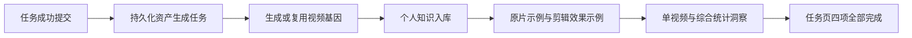

# 任务完成后的自动资产更新

视频结构分析或端到端任务成功后，自动生成/复用视频基因、提炼个人知识、生成实拍剪辑示例和原片示例，并保存统计洞察。用户不需要另外点提炼或运行渲染脚本。

贴纸等独立特效也会自动提炼为 `effect_type`，不限于原有五类概括性知识。已有基因增量补齐，不因曾提炼过而漏掉新识别的效果。详见[贴纸与独立特效知识](贴纸与独立特效知识.md)。

## 触发与状态

- 成片或参考视频分析成功，与 `LearningJob` 入队在同一数据库事务提交。分镜等待确认时不会假报成片资产已完成。
- 独立基因分析到 `DONE` 时，也在同一事务创建后续资产生成任务。
- 后台独立队列按基因、知识、示例、洞察四步执行，状态写入数据库，任务页通过 WebSocket 和轮询自动显示。
- 中途失败最多尝试三次，使用退避等待；成片保持成功并可下载。最终失败可以在任务页重试。服务重启后将中断中的任务恢复为待处理。
- 已有基因和知识按来源幂等复用，不为相同参考重复入库。单独素材分析任务不伪造视频基因。

## 真实示例的来源

优先使用该次任务中的不同实拍素材，按场景、视觉钩子、动作、细节、趣味与高潮等线索选择互补片段。素材清单在任务成功时记录，生成前检查文件身份，避免项目修改后将另一批素材归入旧任务。

可用独立实拍素材不足或技法尚未实现时，效果示例标为待补齐，保留原片参考；参考片截取不再作为效果示例。已知的素材/能力缺口记入 pending_examples，示例阶段显示部分待补齐，不冒充全部完成，也不为同一缺口无限重试。实际渲染失败仍会重试。

示例用到的片段规范化并保存在基因目录的 `example_materials` 下，避免后续删除项目破坏已有示例。效果示例使用与系统技法相同的单画面竖屏播放，与原片分别保存，知识详情可以切换查看。示例不再依赖指定参考片哈希或手工素材目录。

## 洞察与前端

后台完成知识与示例后，自动挖掘当前用户的报告，写入 `users/{user_id}/insights/snapshot.json` 和 HTML 报告。统计洞察接口优先读取仍然有效的快照，基因库变化后不会返回旧快照。该机制保留原有按需计算入口，以兼容历史数据。

任务页的“任务资产自动更新”展示四项状态、知识与示例数量、失败原因和对应页面入口。正常完成后的面板不再持续轮询。历史任务没有生成记录时，可以补齐；新任务自动触发。

## 验证记录

真实任务 **#12（视频结构分析）** 自动触发完整链路：复用基因 #6 和已有 5 条知识，自动生成 5 个实拍剪辑示例，保留 5 个原片示例，生成含 6 个视频样本的统计洞察。示例生成期间没有调用手工提炼或渲染命令。打开洞察页前快照已经存在，任务页无需刷新就自动变为四项完成。

本次验证复用了已有参考分析，未重新调用视觉模型。对新参考的基因创建、知识入库、重复执行、失败重试、重启恢复、用户隔离和任务来源变更的保护，由集成测试覆盖。示例视频实际解码共 1800 帧，并验证音轨。

验证文件：`data/automatic-assets-checks.json`、`data/automatic-assets-media-checks.json`、`data/automatic-assets-ui-checks.json`。主要代码：`web/backend/learning_service.py`、`learning_materials.py`、`insight_cache.py` 与 `tests/test_learning_lifecycle.py`。
